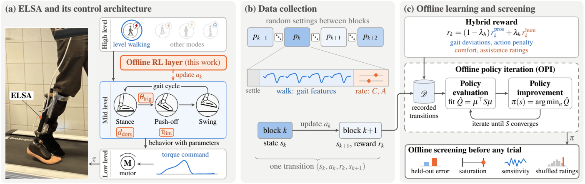
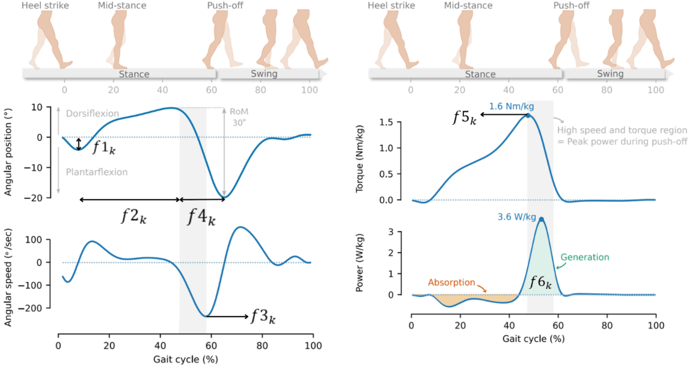
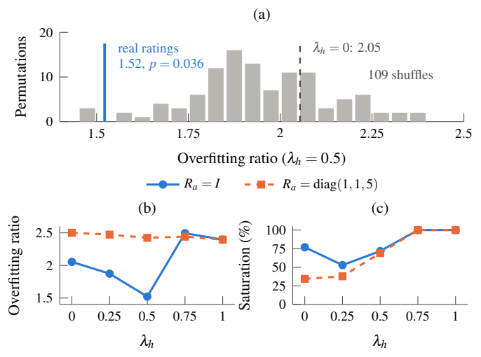

# CARE-RL-LA


This repository contains the code of the paper **"Evaluating Human-Informed Offline Reinforcement Learning for Control Parameter Tuning of a Powered Ankle Prosthesis"** (R. Vassart, L. Marsano Da Costa Nunes, R. Ronsse, E. Piette, UCLouvain; submitted to IEEE ICORR 2027).

Powered ankle prostheses are still tuned by hand: an expert watches the gait, listens to the user and adjusts control parameters one by one. This project asks whether that tuning can be learned from recorded walking data alone, with a reward that combines **how far the gait is from normative gait** and **how the user rates the setting** (comfort and perceived assistance). The code learns a policy with **offline policy iteration (OPI)** and then puts it through a set of **offline checks** that decide, before anyone walks with it, whether the policy is fit for a supervised trial.

<p align="center">
  
</p>
<p align="center"><sub><b>Overview of the study.</b> (a) ELSA, worn by an able-bodied participant through an adapter, and its three control levels. The offline RL layer tunes three mid-level parameters (orange); its update is not applied in this study (dashed). (b) Data collection: the setting changes at random between walking blocks; each block gives gait features and two ratings, and two consecutive blocks form one transition. (c) Offline learning: a hybrid reward, offline policy iteration, and the offline screening of the policy.</sub></p>

### In short

* **Device**: ELSA, a foot-size powered ankle prosthesis ([Heremans et al., 2025](#references))
* **What is tuned**: 3 mid-level control parameters: dorsiflexion damping $d_\mathrm{dors}$, push-off trigger angle $\theta_\mathrm{trig}$, push-off torque limit $\tau_\mathrm{lim}$
* **State**: 6 gait features measured by the prosthesis, as deviations from normative gait
* **Reward**: deviations from normative gait + user ratings of comfort and assistance, weighted by $\lambda_h$
* **Learning**: offline policy iteration with a quadratic cost-to-go ([Li et al., 2019; 2022](#references)), solved with CVXPY
* **Data**: 1 able-bodied participant, 55 walking blocks, **52 transitions** (data not included, see [Data](#6-data))
* **Screening**: generalization (purged cross-validation), saturation, sensitivity, permutation test of the ratings


---

## Contents

1. [Background](#1-background)
2. [Method](#2-method)
3. [Main results](#3-main-results)
4. [Repository layout](#4-repository-layout)
5. [Installation](#5-installation)
6. [Data](#6-data)
7. [Usage and reproduction of the paper](#7-usage-and-reproduction-of-the-paper)
8. [Implementation notes](#8-implementation-notes)
9. [Citation](#9-citation)
10. [References](#references)

---

## 1. Background

**Why the ankle, and why the user's judgment?**
In level walking the knee absorbs more energy than it generates, whereas the ankle produces the largest burst of positive power of the gait cycle, at push-off. A powered ankle therefore decides how much energy is injected into the gait and when, and users are sensitive to that choice. Earlier reinforcement learning (RL) tuners mostly targeted knee prostheses and used purely biomechanical rewards, while preference-based methods use the user's judgment but return a single setting that does not adapt to the gait. This project puts the two together: the user's ratings enter the RL reward, next to a biomechanical reference that keeps the updates physically meaningful.

**The ELSA prosthesis and its control levels.**
ELSA has three control levels (panel (a) above):

* the **high level** selects the locomotion mode (this study is restricted to level walking);
* the **mid level** is a finite-state impedance controller, $\tau = k(\theta-\theta_\mathrm{ref}) + d\,\dot\theta$
  in each gait phase, plus a push-off triggered at an angle $\theta_\mathrm{trig}$ and capped at a torque $\tau_\mathrm{lim}$;
* the **low level** tracks the torque commands with the motor.

The offline RL layer sits between the high and mid levels: it **supervises the existing controller** by recommending bounded updates of three of its parameters, and never touches the low-level safety limits.

| Parameter | Role | Admissible range | Name in the code |
|---|---|---|---|
| $d_\mathrm{dors}$ | dorsiflexion damping, resists dorsiflexion during the rollover of stance | 9.74 – 28.65 N·m·s/rad | `d_dors` |
| $\theta_\mathrm{trig}$ | push-off trigger angle, sets when push-off starts | 3 – 11° (0.052 – 0.192 rad) | `theta` / `theta_trig` |
| $\tau_\mathrm{lim}$ | push-off torque limit, sets how much torque push-off may deliver | 10 – 60 N·m | `tau_lim` |

---

## 2. Method

### 2.1 A block-level decision process

The decision step is a **walking block** of 60 gait cycles on a treadmill, during which the three parameters $p_k = [d_\mathrm{dors}, \theta_\mathrm{trig}, \tau_\mathrm{lim}]_k^\top$ are held fixed. The first 5 cycles are a transition between settings, the gait features are extracted from the next 40, and the participant gives the two ratings during the last 15.

**State.** Six event-based features $f^i$, computed for each gait cycle from the prosthesis recordings:
<p align="center">
  
</p>

| | Feature | Column in the data |
|---|---|---|
| $f^1$ | plantarflexion drop after heel strike, $\theta(t_\mathrm{MPA}) - \theta(t_\mathrm{HS})$ | `f1_drop_deg_signed` |
| $f^2$ | delay from maximal plantarflexion to push-off onset | `f2_mpa_to_pushoff_time` |
| $f^3$ | peak ankle angular speed during push-off | `f3_max_abs_speed_pushoff` |
| $f^4$ | push-off duration | `f4_pushoff_duration` |
| $f^5$ | peak ankle torque during push-off, per unit body mass | `f5_peak_torque_pushoff_norm` |
| $f^6$ | mechanical energy generated during push-off, per unit body mass | `f6_generated_mechanical_energy_norm` |

<sub>HS: heel strike; MPA: first maximal plantarflexion after HS. The curves of the figure are illustrative healthy profiles.</sub>

Each feature enters the state as a standardized deviation from a normative value,

```math
s_k^i = \frac{f_k^i - f_\mathrm{ref}^i}{\sigma^i}, \qquad i = 1,\dots,6,
```

where $f_\mathrm{ref}^i$ is the median of the feature in a public dataset of healthy adults walking at controlled speeds ([Moreira et al., 2021](#references); table included in `data/`), and $\sigma^i$ is the standard deviation of the feature over all recorded gait cycles of the participant (`dataset_builder.py --sigma-source empirical`, which keeps the six deviations on comparable scales).


**Action.** The update between two blocks, $a_k = p_{k+1} - p_k$, bounded so that the next setting stays in the admissible range: $p_\mathrm{min} - p_k \le a_k \le p_\mathrm{max} - p_k$. Learning increments mirrors how a prosthetist corrects the current setting. The parameters are not part of the state, so the policy maps gait
deviations to corrections.


### 2.2 Hybrid reward

The reward of the transition $k \to k+1$ is computed on block $k+1$, the block produced by the update (`reward_from="next"`). It mixes a prosthesis term and a human term:

```math
r_k = (1-\lambda_h)\, r_k^\mathrm{pros} + \lambda_h\, r_k^\mathrm{hum}, \qquad \lambda_h \in [0,1],
```

```math
r_k^\mathrm{pros} = -\sum_{i=1}^{6} w_i \left(s_{k+1}^i\right)^2 \;-\; \bar a_k^\top R_a\, \bar a_k,
\qquad
r_k^\mathrm{hum} = \alpha\, \tilde C_{k+1} + (1-\alpha)\, \tilde A_{k+1},
```

where $\bar a_k$ is the update divided by the half-range of each parameter, $w_i$ are uniform, $R_a = I$ and $\alpha = 0.5$ unless stated otherwise. $\tilde C$ and $\tilde A$ are z-scores of the comfort and assistance ratings over the blocks of the participant (over the training pairs alone in cross-validation). Both ratings use 0–10 scales, but the assistance scale is bipolar (0: no assistance felt, 5: appropriate, 10: far too strong), so the code standardizes $-|A-5|$ rather than $A$.

$\lambda_h = 0$ gives a purely biomechanical reward. Since $r^\mathrm{pros}$ also carries the action penalty, $\lambda_h = 1$ removes the penalty too; `--action-cost separate` keeps it outside the weighting: $r_k = (1-\lambda_h)\, r_k^\mathrm{gait} + \lambda_h\, r_k^\mathrm{hum} - \bar a_k^\top R_a \bar a_k$.


### 2.3 Dataset: all-to-all pseudo-transitions

55 blocks were recorded; one was excluded after a recording error, along with its two transitions, which leaves **52 transitions**. With 52 transitions for 55 coefficients to learn, a fit on block-averaged states would be barely identified, so every gait cycle of block $k$ is paired with every gait cycle of block $k+1$: 40 × 40 = **1600 pseudo-transitions per block pair, 83,200 in total**. The pseudo-transitions of a pair share its action and ratings and differ only in their gait states. This stabilizes the regression but adds no evidence: only 52 parameter changes are independent, which is why every split and every permutation below works on whole block pairs.

### 2.4 Offline policy iteration

Following Li et al. (2019, 2022), the action-value function is quadratic in the joint state-action vector,

```math
\hat Q(s,a) = \mu^\top S\, \mu, \qquad \mu = [\,1;\ s;\ a\,] \in \mathbb{R}^{10},
```

with $S$ symmetric (55 free coefficients). Rewards are mapped to non-negative costs by a constant shift, $U_k = c - r_k$ with $c = \max_j r_j + 10^{-3}$, and the features are rescaled to $[-1,1]$. Starting from the zero-update policy, OPI alternates:

* **policy evaluation**, a least-squares fit of the Bellman equation with $\gamma = 0.9$, solved as a semidefinite program in which only the action block is constrained, $S_{aa} \succeq \epsilon I$;
* **policy improvement**, $\pi(s) = \arg\min_{a \in \mathcal{A}(p)} \hat Q(s,a)$, a box-bounded quadratic program solved for each state.

Iterations stop when the change in $S$ falls below a tolerance, or when it stagnates or cycles; in that case the iterate with the smallest change in $S$ is kept.

### 2.5 Offline screening

A low training error does not show that a policy learned from 52 transitions is fit for a trial. Before such a
policy changes a person's push-off, it goes through four checks that use the recorded data only:

1. **Generalization.** Overfitting ratio = validation-to-training Bellman RMSE, averaged over 5 contiguous folds of block pairs (closer to 1 is better). Consecutive pairs share a block, so the pairs that share a block across a split are purged. The main protocol purges on the validation side (`--cv-purge validation`); the training-side purge (`--cv-purge training`) is reported as a sensitivity analysis. Feature rescaling, cost shift and rating z-scores are computed on the training pairs of each fold (`--cv-rating-stats fold`).
2. **Saturation.** Share of states for which the greedy update sends at least one parameter to a bound, with the eigenvalues of $S_{aa}$ as the explanation (a small eigenvalue means the data barely penalize moving in that direction).
3. **Sensitivity.** Change of the update per unit of gait perturbation (Gaussian noise of 2 % of each feature's standard deviation), reported at its 95th percentile.
4. **Permutation test.** The 52 (comfort, assistance) pairs are shuffled across block pairs and the baseline is refitted 109 times with the same folds and settings, to check that the ratings help through their content and not only as a second, noisy reward term.

The real-rating and shuffled-rating policies are also compared state by state, and the ratings are tested for a trend, for a correlation between consecutive blocks, and against each parameter.

---

## 3. Main results

<p align="center">
  
</p>
<p align="center"><sub>(a) Overfitting ratio of the baseline (λ<sub>h</sub> = 0.5) with the real ratings and with 109 shuffled ratings, and of the objective-only reward (λ<sub>h</sub> = 0). (b, c) Overfitting ratio and saturation versus λ<sub>h</sub> for both action penalties.</sub></p>

| Reward | Overfit ratio | Saturation (%) | Sensitivity p95 |
|---|---:|---:|---:|
| Objective-only, $\lambda_h = 0$ | 2.05 | 76.9 | 1.21 |
| Hybrid, $\lambda_h = 0.25$ | 1.87 | 52.9 | 0.68 |
| **Hybrid, $\lambda_h = 0.5$ (baseline)** | **1.52** | 71.7 | 0.71 |
| Hybrid, $\lambda_h = 0.75$ | 2.49 | 100 | 1.79 |
| Rating-only, $\lambda_h = 1$ | 2.40 | 100 | 6.85 |
| Rating-only, action penalty kept | 2.59 | 10.1 | 0.32 |
| Shuffled ratings, $\lambda_h = 0.5$ (mean of 109) | 1.95 | 70.0 | 1.10 |

<sub>Validation-side purge. Saturation: states with at least one parameter sent to a bound. Sensitivity: 95th percentile of the update change (in half-ranges) per unit of gait perturbation.</sub>

In words:

* Combined with the biomechanical reward, the **real ratings lowered the held-out error** of the learned cost more than 106 of the 109 shuffled-rating controls ($p = 0.036$) under the main protocol, **but not under the training-side purge** ($p = 0.58$), which removes only one or two training pairs per fold. Each fit depends strongly on the few pairs it is trained on.
* Policies learned with real and with shuffled ratings **took similar decisions**, and they often **saturated the bounds**, mostly by sending $\tau_\mathrm{lim}$ to its 60 N·m maximum.
* **Ratings alone** gave unstable ($\lambda_h = 1$) or nearly static (penalty kept) policies.

These data therefore do not show that the ratings improve the policies, nor that they are useless. The evaluation points to three limits to address before a supervised trial: the sensitivity of the learned cost to the training data, the saturation of the updates, and the difficulty of turning ratings into robust decisions. See the paper for the full analysis.

---

## 4. Repository layout

```
.
├── elsa_configOPI.py        configuration: parameter bounds, OPI hyperparameters, reward weights
├── reward.py                hybrid reward (prosthesis term + human term, rating z-scores)
├── dataset_builder.py       raw experimental files -> OPI datasets (block pairs, all-to-all pseudo-transitions)
├── OPI_core.py              offline policy iteration: normalization, SDP policy evaluation, QP policy improvement
├── OPI_validation.py        offline screening: Bellman error, saturation, stability, purged grouped CV
├── run.py                   single entry point: fit + full evaluation of one configuration, saved to results/
├── controls/                controls of the paper, built on a fast equivalent implementation
│   ├── fast_opi.py              FastOPI: same optimization problems, solved much faster
│   ├── check_equivalence.py     checks that FastOPI reproduces OPI_core on your machine
│   ├── controls_common.py       shared loading, configuration and per-fold reward helpers
│   ├── sweep_lambda.py          lambda_h sweep (Table II, Fig. 3b-c)
│   ├── permutation_test.py      permutation test of the ratings (Table II, Fig. 3a)
│   ├── summarize_controls.py    p-values and summary tables from the two scripts above
│   ├── policy_comparison.py     real- vs shuffled-rating policies, state by state
│   └── rating_checks.py         trend, lag-1 correlation and parameter correlations of the ratings
├── examples/
│   └── synthetic_demo.py    smoke test on synthetic data (no participant data needed)
├── data/
│   ├── README.md                expected input files and their format
│   └── reward_ready_normative_feature_refs.csv   normative references (public dataset, Moreira et al. 2021)
├── docs/figures/            figures used in this README
├── requirements.txt
└── LICENSE
```

**What each module does**

| File | Role | Main entry points |
|---|---|---|
| `elsa_configOPI.py` | All settings in two dataclasses: `ProsthesisParams` (bounds of the 3 parameters) and `OPIConfig` (dimensions, $\gamma$, iterations and stopping rules, $\lambda_h$, $\alpha$, assistance coding, action-cost form, $R_a$, SDP floor $\epsilon$, regularization). | `OPIConfig`, `ProsthesisParams` |
| `reward.py` | Computes $r^\mathrm{pros}$, $r^\mathrm{hum}$ and their mix for one transition or a whole batch; calibrates the rating z-scores; codes the bipolar assistance scale. | `RewardComputer.compute_batch`, `fit_human_stats`, `code_assistance` |
| `dataset_builder.py` | Reads the stride-level features, the ratings, the parameter file and the normative table; standardizes the features; pairs consecutive blocks (skipping pairs with a missing block); exports a CSV with full metadata, a pickled `Dataset` and a JSON description. Two kinds: `all_to_all` (used in the paper) and `block_summary` (one transition per pair, block medians). | `ELSADatasetBuilder`, CLI |
| `OPI_core.py` | The learning algorithm: `MinMaxNormalizer`, `ActionNormalizer`, `Transition`/`Dataset` containers, and `OfflinePolicyIteration` (`fit`, `predict`), with the SDP solved by CLARABEL (SCS as fallback). | `OfflinePolicyIteration` |
| `OPI_validation.py` | The screening: Bellman residuals, action distribution and saturation, policy-improvement check, stability to state noise, grouped K-fold CV with purge; text and JSON reports. | `OPIEvaluator`, `cross_validate`, `make_cv_splits`, `run_full_evaluation` |
| `run.py` | Loads a dataset, recomputes the rewards from the source files for the chosen options, prints a reward-composition diagnostic, fits OPI, runs the whole screening and saves everything needed to redraw the plots. | CLI |
| `controls/` | The paper's controls, each fitting OPI tens to hundreds of times, use `FastOPI`, which solves the same problems faster (see [Implementation notes](#8-implementation-notes)). | one CLI per script |

---

## 5. Installation

Python 3.10 or later. From the root of the repository:

```bash
python -m venv .venv
source .venv/bin/activate            # Windows: .venv\Scripts\activate
pip install -r requirements.txt
```

Dependencies: NumPy, pandas, SciPy and CVXPY (which installs the CLARABEL and SCS solvers). The code was last tested with Python 3.13, NumPy 2.5, pandas 3.0, SciPy 1.18 and CVXPY 1.9.

Check the installation without any participant data (about 20 s):

```bash
python examples/synthetic_demo.py
```

It fits both implementations on a small synthetic dataset, checks that they learn the same $S$ matrix and prints a recommended update. The synthetic numbers have no physical meaning.

---

## 6. Data

**The participant data are not included in this repository.** They were collected from one able-bodied participant under the approval of the Comité d'Ethique Hospitalo-Facultaire des Cliniques universitaires Saint-Luc (EudraCT 2021-000393-28) and are not distributed. The only data file included is the table of normative references, derived from the public dataset of [Moreira et al. (2021)](#references).

The code expects the files below in `data/` (ignored by git). [`data/README.md`](data/README.md) describes their columns, so the pipeline can be run on another participant's data.

| File | Content | Used by |
|---|---|---|
| `ExpS1_Full_final_features.csv` | one row per gait cycle: block id, cycle index, the gait features | `dataset_builder.py` |
| `ExpS1_Full_scores.csv` | one row per block: comfort and assistance ratings | `dataset_builder.py`, `run.py`, controls |
| `S1_exp_params.c` | the parameter setting of each block, in the order of the protocol | `dataset_builder.py` |
| `reward_ready_normative_feature_refs.csv` | normative median and dispersion of each feature (**included**) | `dataset_builder.py` |
| `all_to_all_transitions.csv`, `all_to_all_opi_dataset.pkl` | built dataset (output of `dataset_builder.py`) | `run.py`, controls |

---

## 7. Usage and reproduction of the paper

All commands are run from the root of the repository. Results are written to `results/` (ignored by git).

### Step 1: build the dataset

```bash
python dataset_builder.py \
    --feature-csv data/ExpS1_Full_final_features.csv \
    --score-csv data/ExpS1_Full_scores.csv \
    --param-c-file data/S1_exp_params.c \
    --normative-ref-csv data/reward_ready_normative_feature_refs.csv \
    --features f1 f2 f3 f4 f5 f6 --n-features 6 \
    --dataset-kinds all_to_all --sigma-source empirical \
    --output-dir data
```

This writes `all_to_all_transitions.csv`, `all_to_all_opi_dataset.pkl` and `all_to_all_metadata.json`. The block without features is detected and its two transitions are skipped, which leaves 52 block pairs and 83,200 rows. With these options the build reproduces the dataset of the paper exactly.

### Step 2: fit and screen one configuration

```bash
python run.py \
    --pickle data/all_to_all_opi_dataset.pkl \
    --csv data/all_to_all_transitions.csv \
    --score-csv data/ExpS1_Full_scores.csv \
    --tag baseline
```

The defaults are the paper's baseline ($\lambda_h = 0.5$, $\alpha = 0.5$, $\gamma = 0.9$, $R_a = I$, centred assistance, validation-side purge); `python run.py --help` lists every option. The output folder `results/baseline__<timestamp>/` contains the configuration, the reward diagnostic, the model (`model.npz`: $S$, cost shift, training history), the evaluation report (`.json` and `.txt`) and the raw arrays (Bellman residuals, sensitivities, Q-values). This is the reference implementation: on the full dataset one run takes from about half an hour to more than two hours.

### Step 3: the controls of the paper

The controls use `FastOPI`. The equivalence check compares it with the reference implementation on the first 4 block pairs, which takes from a few minutes to about half an hour (see [Implementation notes](#8-implementation-notes) for how to read its output):

```bash
python controls/check_equivalence.py --pickle data/all_to_all_opi_dataset.pkl --csv data/all_to_all_transitions.csv
```

Then:

```bash
D="--pickle data/all_to_all_opi_dataset.pkl --csv data/all_to_all_transitions.csv --score-csv data/ExpS1_Full_scores.csv"

# lambda_h sweeps (5 values each)
python controls/sweep_lambda.py $D --out results/controls/sweep_ra1.jsonl
python controls/sweep_lambda.py $D --ra-scale-tau-lim 5 --out results/controls/sweep_ra5.jsonl
python controls/sweep_lambda.py $D --lambdas 1 --action-cost separate --out results/controls/sweep_ra1_separate.jsonl

# permutation test: replicate 0 = real ratings, 1..109 = shuffled (seed 20261007 + j)
python controls/permutation_test.py $D --out results/controls/permutation.jsonl
python controls/permutation_test.py $D --cv-purge training --out results/controls/permutation_purge_training.jsonl

# summaries and comparisons
python controls/summarize_controls.py --perm results/controls/permutation*.jsonl --sweep results/controls/sweep_*.jsonl
python controls/policy_comparison.py $D --perm results/controls/permutation.jsonl --sweep results/controls/sweep_ra1.jsonl
python controls/rating_checks.py --csv data/all_to_all_transitions.csv --score-csv data/ExpS1_Full_scores.csv
```

One fit with its 5-fold cross-validation takes a few minutes (about 3.5 min on a 4-core machine), so a sweep takes about 20 minutes and each permutation test a few hours. `--start` and `--stop` split the 110 replicates across processes or cluster jobs, and every script appends one JSON line per fit and skips the fits already in its output file, so an interrupted job can be resumed.

---

## 8. Implementation notes

**FastOPI** (`controls/fast_opi.py`) solves exactly the same problems as `OPI_core.py`, faster:

* *Policy evaluation.* With a thin QR factorization $D = QR$ of the $(N \times 100)$ design matrix, $\lVert D\,\mathrm{vec}(S) - U\rVert^2 = \lVert R\,\mathrm{vec}(S) - Q^\top U\rVert^2 + \mathrm{const}$, so the SDP keeps the same minimizer but receives 100 residuals instead of 83,200.
* *Policy improvement.* For each state the problem is $\min_a a^\top H a + 2 g^\top a$ on a 3-D box with $H = S_{aa} \succ 0$. Its exact solution is found by enumerating the $3^3 = 27$ active sets (each dimension free, at its lower bound or at its upper bound) for all states at once with NumPy.

Normalization, cost shift, initial policy, stopping rules, the choice of the kept iterate, the metrics, the folds,the purge and the per-fold rewards are inherited unchanged. `check_equivalence.py` compares both implementations (Frobenius history, final $S$, greedy actions, saturation, sensitivity, Bellman error).

---

## 9. Citation

If you use this code, please cite the paper (citation to be updated after review):

```bibtex
@unpublished{vassart2027humanopi,
  author = {Vassart, Rapha{\"e}l and Marsano Da Costa Nunes, Luana and Ronsse, Renaud and Piette, Eric},
  title  = {Evaluating Human-Informed Offline Reinforcement Learning for Control Parameter Tuning of a Powered Ankle Prosthesis},
  note   = {Submitted to the IEEE International Conference on Rehabilitation Robotics (ICORR) 2027},
  year   = {2026}
}
```

## References

* F. Heremans, J. Evrard, D. Langlois and R. Ronsse, "ELSA: A foot-size powered prosthesis reproducing ankle dynamics during various locomotion tasks," *IEEE Trans. Robot.*, vol. 41, pp. 415–429, 2025.
* M. Li, X. Gao, Y. Wen, J. Si and H. H. Huang, "Offline policy iteration based reinforcement learning controller for online robotic knee prosthesis parameter tuning," in *Proc. IEEE ICRA*, pp. 2831–2837, 2019.
* M. Li, Y. Wen, X. Gao, J. Si and H. H. Huang, "Toward expedited impedance tuning of a robotic prosthesis for personalized gait assistance by reinforcement learning control," *IEEE Trans. Robot.*, vol. 38, no. 1, pp. 407–420, 2022.
* L. Moreira, J. Figueiredo, P. Fonseca, J. P. Vilas-Boas and C. P. Santos, "Lower limb kinematic, kinetic, and EMG data from young healthy humans during walking at controlled speeds," *Sci. Data*, vol. 8, p. 103, 2021.
* S. Diamond and S. Boyd, "CVXPY: A Python-embedded modeling language for convex optimization," *J. Mach. Learn. Res.*, vol. 17, no. 83, pp. 1–5, 2016.

## License and contact

The code is released under the MIT License (see [`LICENSE`](LICENSE)). Questions and remarks are welcome through the issues of this repository, or by e-mail to the authors (addresses in the paper).